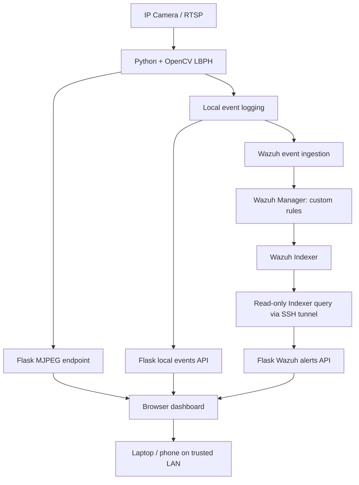

# HEXA Vision

### Computer Vision–Driven Security Monitoring with Wazuh SIEM

**Project type:** Personal cybersecurity / detection engineering lab  
**Status:** Working local prototype; security hardening in progress  
**Stack:** Python · OpenCV (LBPH) · Flask · JavaScript · HTML/CSS · Wazuh · REST APIs · Windows · Ubuntu · RTSP

> HEXA Vision is a personal security-monitoring prototype that combines a live IP-camera stream, face-recognition events, and Wazuh SIEM alerts in a browser dashboard accessible from a laptop or phone on a trusted local network.

## Project overview

I developed HEXA Vision to explore how physical-security telemetry can be incorporated into a security operations workflow. The system uses an RTSP camera feed and OpenCV-based face recognition to classify observed faces as **recognized** or **unknown**. Detection events are logged locally and forwarded to Wazuh, where custom rules generate security alerts. A Flask application displays the live camera stream, local events, and Wazuh alerts in a single dashboard.

**This is a learning prototype, not a production-grade identity verification or surveillance system.** Face-recognition classifications can be wrong and should not be treated as proof of identity or wrongdoing.

## System architecture

## Features implemented

- **Live camera viewing:** Streams an RTSP IP-camera feed into a Flask-served browser dashboard.
- **Face-recognition event generation:** Uses OpenCV's LBPH recognizer to distinguish recognized versus unknown faces in a controlled lab.
- **Local event logging:** Records recognition events as JSON with a cooldown to reduce repetitive events.
- **Wazuh custom detections:** Detects unknown and recognized faces and includes a repeated-unknown-event correlation rule.
- **SIEM integration:** Queries Wazuh alert indices with a dedicated read-only account over a local SSH tunnel.
- **Unified dashboard:** Displays camera footage, local recognition events, and SIEM alert details.
- **Automatic refresh:** Polls local events every 5 seconds and Wazuh alerts every 10 seconds.
- **Mobile access:** Tested browser access from an iPhone on the same Wi-Fi network.

## Detection use cases

| Wazuh rule | Lab detection | Severity |
|---|---|---:|
| `100800` | Base HEXA Vision event rule | Depends on configuration |
| `100801` | Unknown face observed | Level 7 |
| `100802` | Recognized face observed | Level 3 |
| `100803` | Three unknown-face events within 120 seconds | Level 8 |

*Rule behavior should be validated against the currently deployed Wazuh configuration. A correlation alert is not proof of an intrusion.*

## Verified lab results

- The Flask `/api/wazuh-alerts` endpoint returned a successful response containing Wazuh alert records with timestamps, agent names, rule IDs, severity levels, and recognition outcomes.
- Alerts for rules `100801` and `100802` were observed in the API response.
- The integrated dashboard was confirmed working after JavaScript integration.
- The dashboard was successfully opened from an iPhone on the local Wi-Fi network.

## Security design and limitations

- A **read-only Wazuh Indexer role** was configured for alert retrieval.
- Indexer access is routed through an **SSH tunnel**, rather than exposing its search port to the LAN.
- Credentials are supplied to the backend using environment variables; they must never be committed to Git.
- Dashboard event text is rendered with `textContent` to avoid interpreting alert content as HTML.
- **Current limitation:** The Flask prototype was temporarily bound to the LAN for phone testing and does **not yet have application authentication or HTTPS**. It should not be exposed to the internet or used with sensitive footage until secured.
- **Current limitation:** The Indexer client temporarily disables TLS certificate verification for a self-signed lab certificate. Replace this with trusted CA verification before deployment.
- **Current limitation:** LBPH face recognition can produce false matches, especially under different lighting, angles, and camera conditions.

## Screenshots

Add sanitized screenshots in `docs/screenshots/` after reviewing for private IP addresses, identities, camera footage, credentials, and other sensitive details.

Suggested images:

1. `dashboard-desktop.png` — full dashboard, with camera image blurred or replaced with consented test imagery
2. `wazuh-alerts.png` — Wazuh rules and alerts, with identifiers redacted
3. `dashboard-mobile.png` — phone view showing responsive access

## Repository contents

This initial portfolio package provides **documentation and sanitized examples**. It does not contain the user's actual working project source files, which should be reviewed and added separately.

- [`docs/architecture.md`](docs/architecture.md) — data flow and component responsibilities
- [`docs/testing.md`](docs/testing.md) — manual test cases and evidence checklist
- [`docs/security.md`](docs/security.md) — threat considerations and hardening roadmap
- [`examples/example-alert.json`](examples/example-alert.json) — fictional, sanitized alert schema
- [`.gitignore`](.gitignore) — exclusions for credentials, virtual environments, footage, and models

## Next improvements

1. Add login authentication, authorization, HTTPS, and CSRF protections as appropriate.
2. Replace temporary TLS verification bypass with the Wazuh Indexer CA certificate.
3. Improve mobile layout and severity-based alert visualization.
4. Add test coverage for API failures, invalid responses, and detection event schemas.
5. Evaluate detection accuracy and false-positive/false-negative rates on consented test data.
6. Consider private VPN access instead of exposing Flask to the public internet.

## Skills demonstrated

**Security engineering:** SIEM integration, detection rules, alert triage, least privilege, secure service connectivity  
**Software development:** Python, Flask, REST APIs, JavaScript, JSON, asynchronous polling  
**Infrastructure:** Windows, Ubuntu, SSH port forwarding, IP networking, RTSP streaming  
**Computer vision:** OpenCV, LBPH-based recognition, event classification

## Ethics and privacy

HEXA Vision is intended for authorized testing with consent. Do not collect or publish identifiable footage or biometric templates without permission. Avoid using face-recognition outcomes as sole grounds for consequential decisions.

## Author

**Connor Riordan** — Aspiring Cybersecurity Professional  
Cybersecurity student and hands-on security lab builder.
